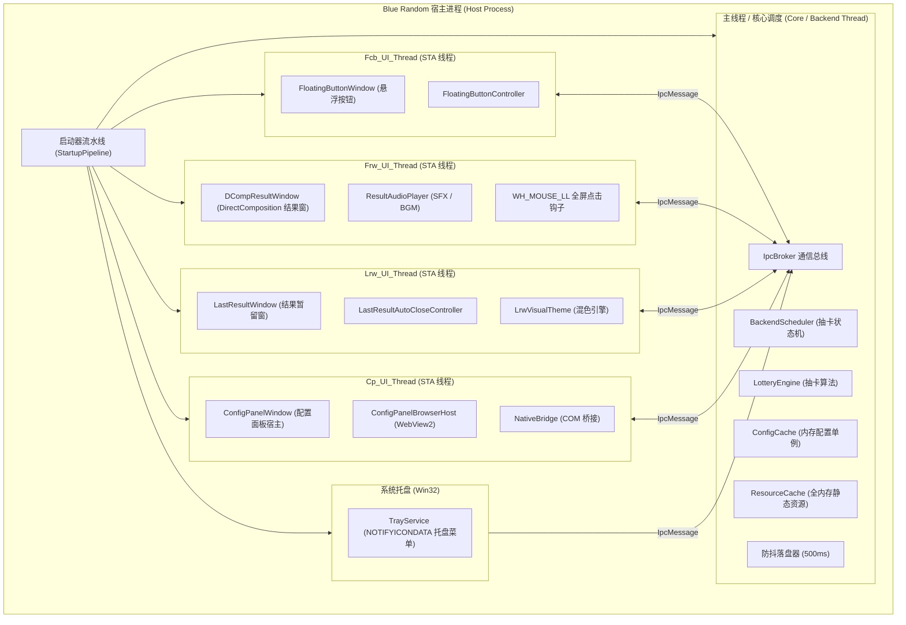
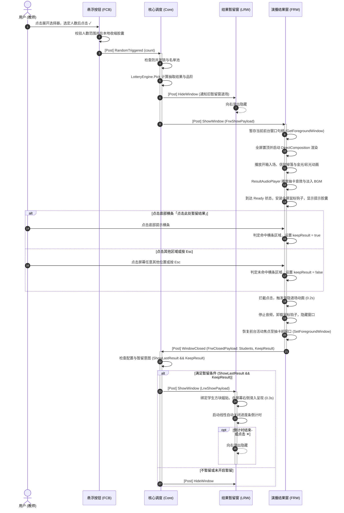
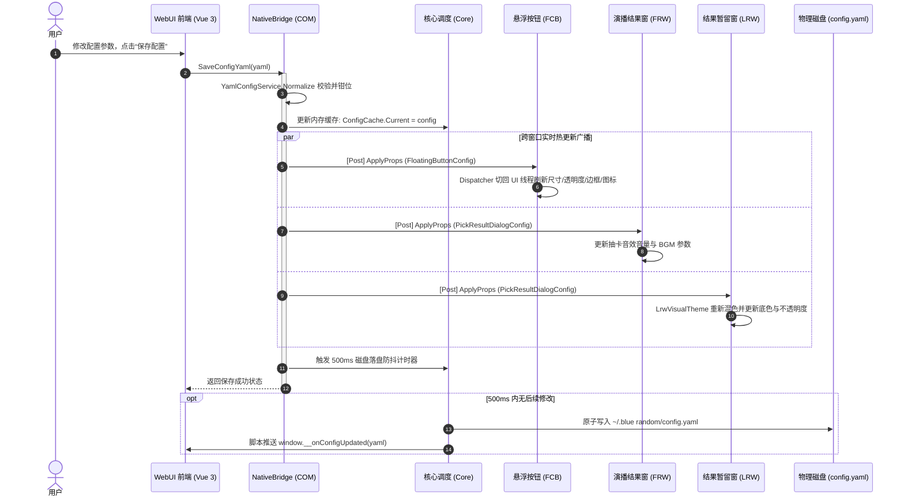
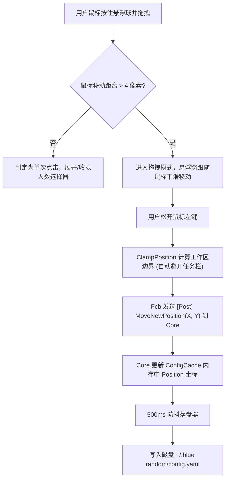
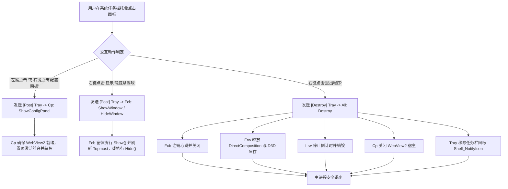

# Blue Random 系统架构与进程内 IPC 通信规范

本文档系统性说明 **Blue Random（蔚蓝点名）** 的进程与线程拓扑架构，以及基于发布/订阅模型的进程内通信总线（`IpcBroker`）的通信协议规范、命令字字典与可视化交互时序流程。

---

## 一、 进程与线程拓扑全景

Blue Random 运行于单个 Windows 原生进程内，内部划分为 1 个后台控制调度中枢与 4 个职责独立的 STA（Single Thread Apartment）UI 线程。



### 线程分工与职责说明
1. **主线程 / 核心调度 (Core / Backend Thread)**: 承载程序生命周期、`IpcBroker` 消息总线、抽卡状态机、加权无偏抽卡算法（`LotteryEngine`）、无锁内存配置缓存（`ConfigCache`）、全内存静态资源缓存（`ResourceCache`）与 500ms 磁盘防抖落盘器。
2. **悬浮按钮独立线程 (Fcb_UI_Thread - STA)**: 专职承载桌面常驻透明悬浮按钮（`FloatingButtonWindow`），运行极坐标圆弧排版、非模态平滑屏幕坐标拖拽、原生触控事件捕获与 CubicEase 贝塞尔弹性展开动效；注入 Win32 `WS_EX_NOACTIVATE` 扩展样式与拦截 `WM_MOUSEACTIVATE`，确保移动与点击悬浮球时绝对不抢占前台全屏放映 PPT 的焦点。
3. **结果演播窗独立线程 (Frw_UI_Thread - STA)**: 专职承载 DirectComposition + D3D11 + D2D 透明硬件加速演播窗（`DCompResultWindow`），自有 Win32 消息循环泵与独立 WH_MOUSE_LL 全屏点击关闭钩子线程；在弹出前记录前台活动窗口并在关闭后自动精准归还焦点，保障翻页笔操作无缝连贯。
4. **结果暂留窗独立线程 (Lrw_UI_Thread - STA)**: 专职承载屏幕右上角常驻卡片（`LastResultWindow`），负责平滑滑入滑出动效与线性收缩自动关闭进度条。
5. **配置面板独立线程 (Cp_UI_Thread - STA)**: 唯一承载设置面板（`ConfigPanelWindow`）与 Microsoft WebView2 浏览器的 UI 线程，提供 NativeBridge COM 宿主直连对象，支持窗口隐藏式常驻秒开，杜绝 COM 跨套间异常。

---

## 二、 进程内通信总线 (`IpcBroker`) 协议模型

### 1. 通信主体与动作语义
- **参与模块 (`IpcModule`)**:
  - `Core`: 核心后台调度器 (`BackendScheduler`)
  - `Fcb`: 悬浮按钮模块 (`FloatingButtonWindow` / `FloatingButtonController`)
  - `Frw`: 结果演播窗模块 (`DCompResultWindow`)
  - `Lrw`: 结果暂留窗模块 (`LastResultWindow` / `LastResultPresenter`)
  - `Cp`: 配置面板宿主模块 (`ConfigPanelWindow` / `ConfigPanelBrowserHost`)
  - `Tray`: 原生系统托盘服务 (`TrayService`)

- **动作语义 (`IpcAction`)**:
  - `Post`: 单向投递事件（非阻塞，发后即忘，用于状态变更与动作广播）。
  - `Request`: 发起请求（预留双向协议）。
  - `Response`: 请求回执响应。
  - `Destroy`: 全局终止指令，要求目标模块安全释放资源并关闭消息循环。

- **标准消息封包 (`IpcMessage`)**:
  - `Action` (`IpcAction`): 动作类型。
  - `Sender` (`IpcModule`): 消息发送源。
  - `Target` (`IpcModule`): 目标接收方。
  - `Command` (`string`): 命令字标识符。
  - `Payload` (`object?`): 强类型数据载荷。

---

## 三、 命令字与消息载荷映射字典

| 发送方 | 目标方 | Action | Command | Payload 类型 | 业务语义 |
| :--- | :--- | :--- | :--- | :--- | :--- |
| `Fcb` | `Core` | `Post` | `RandomTriggered` | `int` | 用户在悬浮球点击确认，请求抽取指定人数 (1-10) |
| `Fcb` | `Core` | `Post` | `MoveNewPosition` | `FcbPositionPayload` | 悬浮球被拖拽后上报最新屏幕坐标 (X, Y) |
| `Core` | `Frw` | `Post` | `ShowWindow` | `FrwShowPayload` | 指示演播窗全屏弹出并播放抽卡动画 |
| `Frw` | `Core` | `Post` | `WindowClosed` | `FrwClosedPayload` | 演播窗关闭，上报本轮抽取名单与用户是否主动选择暂留结果 |
| `Core` | `Lrw` | `Post` | `ShowWindow` | `LrwShowPayload` | 指示暂留窗在屏幕右上角滑入展示抽取结果 |
| `Core` | `Lrw` | `Post` | `HideWindow` | `null` | 启动新抽卡时指示暂留窗立即滑出隐藏 |
| `Core` | `Fcb` | `Post` | `ApplyProps` | `FloatingButtonConfig` | 热更新悬浮球尺寸、透明度、边框与图标 |
| `Core` | `Fcb` | `Post` | `ApplyDefaultPickCount` | `int` | 热更新悬浮球默认抽取人数 |
| `Core` | `Frw` | `Post` | `ApplyProps` | `PickResultDialogConfig`| 热更新演播窗音量、BGM 与展示时长配置 |
| `Core` | `Lrw` | `Post` | `ApplyProps` | `PickResultDialogConfig`| 热更新暂留窗底色、不透明度与自动关闭秒数 |
| `Tray` | `Cp` | `Post` | `ShowConfigPanel` | `null` | 托盘左键点击或右键菜单唤起配置面板 |
| `Tray` | `Fcb` | `Post` | `ShowWindow` | `null` | 托盘菜单切换：显示桌面悬浮按钮 |
| `Tray` | `Fcb` | `Post` | `HideWindow` | `null` | 托盘菜单切换：隐藏桌面悬浮按钮 |
| `Tray` | `All` | `Destroy`| `Destroy` | `null` | 退出程序指令，向所有模块下发销毁并终止线程 |

---

## 四、 核心业务通信时序流程图

### 1. 抽卡全生命周期交互时序图


---

### 2. 配置保存与跨窗口实时热更新流程图


---

### 3. 悬浮按钮位置记忆与拖拽持久化流程图


---

### 4. 系统托盘菜单控制流程图


---

## 五、 载荷数据结构定义

### 1. `FcbPositionPayload`
```csharp
public class FcbPositionPayload
{
    public double PositionX { get; set; } // 悬浮球在当前屏幕工作区中的绝对 X 坐标 (DIP)
    public double PositionY { get; set; } // 悬浮球在当前屏幕工作区中的绝对 Y 坐标 (DIP)
}
```

### 2. `FrwShowPayload`
```csharp
public class FrwShowPayload
{
    public List<CalledStudent> CalledStudents { get; set; } // 抽卡命中的学生列表 (含姓名、权重、信封品阶)
    public PickResultDialogConfig Props { get; set; }       // 演播演出外观参数、音量与 BGM 配置快照
}
```

### 3. `LrwShowPayload`
```csharp
public class LrwShowPayload
{
    public List<CalledStudent> CalledStudents { get; set; } // 上一轮抽取命中的学生列表
    public DateTime DrawnAt { get; set; }                   // 抽取触发的时间戳 (用于界面展示如 "14:30 抽取")
}
```

---

## 六、 开发者集成与线程安全约束

1. **执行上下文与线程切换**:
   - `IpcBroker.Send` 属于异步无锁派发，消息消费者的 Handler 会在**发布者所在的线程上下文**被直接调用。
   - **核心戒律**: 若消费者的逻辑包含 WPF 界面修改（如 `Window.Show()`、修改控件属性、启动 Storyboard），**必须**通过该窗口自有的 `Dispatcher.Invoke` 或 `Dispatcher.BeginInvoke` 将操作封送至目标窗口所属的 STA 线程执行，严禁跨线程直接读写非冻结的 UI 元素。

2. **载荷不可变性**:
   - 严禁在 IPC 载荷中传输未冻结的 WPF 元素（如 `Brush`、`UIElement`、`Window` 句柄）。
   - 跨模块只传递纯数据 DTO（如 `string`、`int`、`Payload` 实体），图形对象（如图标、位图）仅能传递已经显式调用 `Freeze()` 冻结后的只读实例。