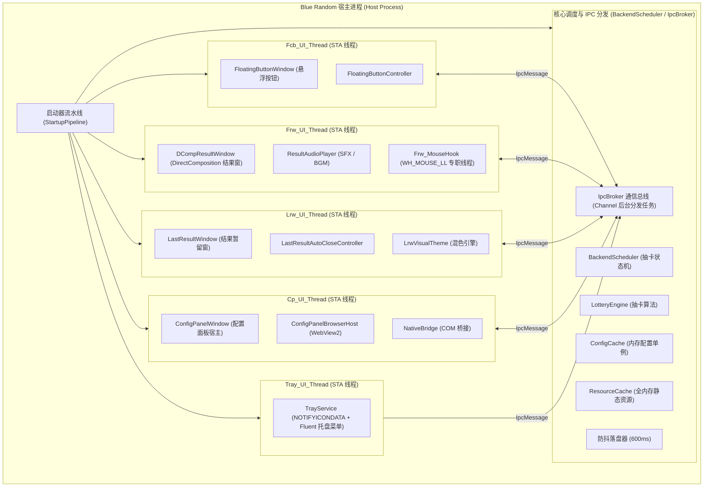
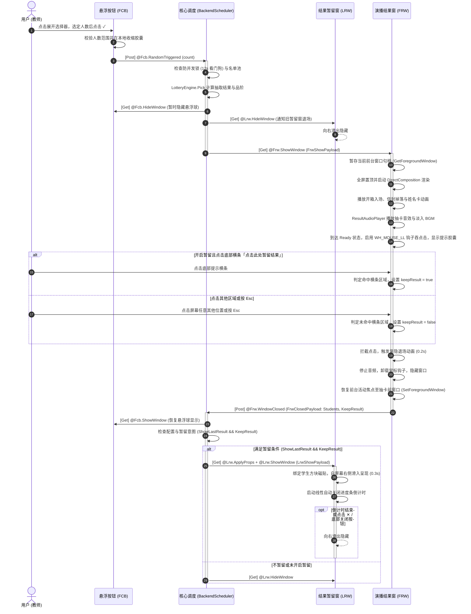
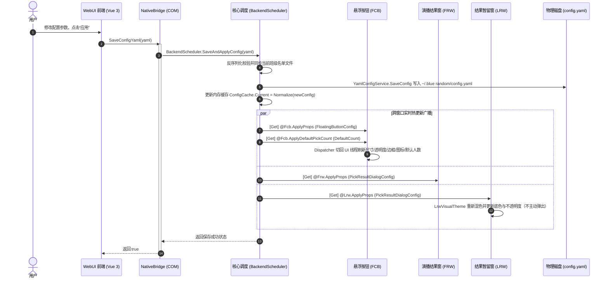
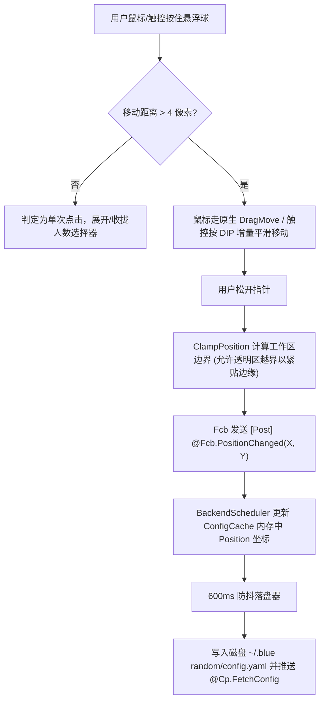
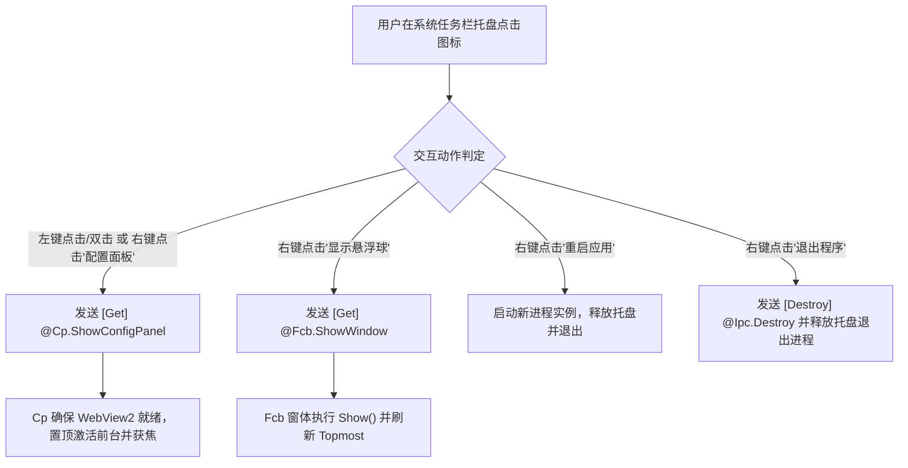

# Blue Random 系统架构与进程内 IPC 通信规范

本文档系统性说明 **Blue Random（蔚蓝点名）** 的进程与线程拓扑架构，以及基于 `System.Threading.Channels` 发布/订阅模型的进程内通信总线（`IpcBroker`）的通信协议规范、命令字字典与可视化交互时序流程。

---

## 一、 进程与线程拓扑全景

Blue Random 运行于单个 Windows 原生进程内，内部划分为 1 个后台控制调度与 IPC 分发中枢，以及 5 个职责独立的 STA（Single Thread Apartment）线程（4 个 UI 窗口线程 + 1 个系统托盘线程；演播窗就绪期间另按需拉起 1 个低级鼠标钩子线程 `Frw_MouseHook`）。



### 线程分工与职责说明
1. **核心调度与 IPC 分发 (`BackendScheduler` / `IpcBroker`)**: 承载程序生命周期、`IpcBroker` 后台异步分发循环（`Channel<IpcMessage>`）、抽卡状态机（含 12 秒防卡死看门狗）、加权抽卡算法（`LotteryEngine`）、线程安全内存配置缓存（`ConfigCache`）、全内存静态资源缓存（`ResourceCache`）与 600ms 磁盘防抖落盘器。
2. **悬浮按钮独立线程 (`Fcb_UI_Thread` - STA)**: 专职承载桌面常驻透明悬浮按钮（`FloatingButtonWindow`），运行极坐标圆弧排版、原生 `DragMove` 拖拽与边缘吸附、触控事件捕获与 `CubicEase` 贝塞尔弹性展开动效；注入 Win32 `WS_EX_NOACTIVATE` / `WS_EX_TOOLWINDOW` 扩展样式并拦截 `WM_MOUSEACTIVATE` 与 `WM_GETMINMAXINFO`，确保移动与点击悬浮球时不抢占前台全屏放映 PPT 的焦点且不触发左右分屏贴靠。
3. **结果演播窗独立线程 (`Frw_UI_Thread` - STA)**: 专职承载 DirectComposition + D3D11 + D2D 透明硬件加速演播窗（`DCompResultWindow`），自有 Win32 消息循环泵，并在就绪期间按需拉起专职 `Frw_MouseHook`（STA）线程运行 `WH_MOUSE_LL` 全屏点击钩子；在弹出前记录前台活动窗口并在关闭后自动精准归还焦点，保障翻页笔操作无缝连贯。
4. **结果暂留窗独立线程 (`Lrw_UI_Thread` - STA)**: 专职承载屏幕右上角常驻卡片（`LastResultWindow`），负责平滑滑入滑出动效与线性收缩自动关闭进度条。
5. **配置面板独立线程 (`Cp_UI_Thread` - STA)**: 唯一承载设置面板（`ConfigPanelWindow`）与 Microsoft WebView2 浏览器的 UI 线程，提供 `NativeBridge` COM 宿主直连对象，支持窗口隐藏式常驻秒开，杜绝 COM 跨套间异常。
6. **系统托盘独立线程 (`Tray_UI_Thread` - STA)**: 承载原生 Win32 `Shell_NotifyIcon` 隐藏消息接收窗口（`BlueRandomTraySink`）与 WPF Fluent 右键上下文菜单。

---

## 二、 进程内通信总线 (`IpcBroker`) 协议模型

### 1. 通信主体与动作语义
- **目标模块枚举 (`IpcModule`)**:
  - `Ipc`: 核心总线 / 全局控制目标（如全局 `Destroy` 指令）
  - `Fcb`: 悬浮按钮模块（`FloatingButtonWindow` 与 `BackendScheduler` 共同订阅）
  - `Frw`: 结果演播窗模块（`DCompResultWindow` 与 `BackendScheduler` 共同订阅）
  - `Lrw`: 结果暂留窗模块（`LastResultWindow` 订阅）
  - `Cp`: 配置面板宿主模块（`ConfigPanelWindow` 与 `BackendScheduler` 共同订阅）
  - 注：`BackendScheduler` 订阅 `Fcb`、`Frw`、`Cp` 上的 `IpcAction.Post` 上报事件；各视图窗口处理发往自身模块的 `IpcAction.Get` / `IpcAction.Destroy` 指令；`TrayService` 作为消息发送方投递指令，不作为 `IpcModule` 枚举成员。

- **动作语义 (`IpcAction`)**:
  - `Init`: 初始化动作（预留）
  - `Destroy`: 全局终止指令，要求目标模块安全释放资源并关闭窗口/消息循环
  - `Get`: 下行控制/同步指令（由调度器、托盘或桥接层发往目标 UI 模块，如 `ShowWindow`、`ApplyProps`、`FetchConfig`）
  - `Post`: 上行事件上报（由 UI 模块或桥接层上报给 `BackendScheduler`，如 `RandomTriggered`、`PositionChanged`、`WindowClosed`、`ConfigSaved`）

- **标准消息封包 (`IpcMessage`)**:
  - `Action` (`IpcAction`): 动作谓词。
  - `Target` (`IpcModule`): 目标接收模块。
  - `Command` (`string`): 命令字标识符。
  - `Payload` (`object?`): 强类型数据载荷。

---

## 三、 命令字与消息载荷映射字典

| 发送方 | 目标 (`Target`) | Action | Command | Payload 类型 | 业务语义 |
| :--- | :--- | :--- | :--- | :--- | :--- |
| `Fcb` | `Fcb` (`BackendScheduler`) | `Post` | `RandomTriggered` | `int` | 用户在悬浮球点击确认，请求抽取指定人数 (1-10) |
| `Fcb` | `Fcb` (`BackendScheduler`) | `Post` | `PositionChanged` | `FcbPositionPayload` | 悬浮球被拖拽后上报最新屏幕坐标 (X, Y) |
| `Fcb` / `Frw` / `Cp` | 对应模块 (`BackendScheduler`) | `Post` | `ErrorHappened` | `string` | 模块运行期异常上报（`Frw` 异常时触发状态自愈） |
| `BackendScheduler` | `Fcb` | `Get` | `HideWindow` | `null` | 抽卡开始时暂时隐藏悬浮按钮 |
| `BackendScheduler` / `Tray` | `Fcb` | `Get` | `ShowWindow` | `null` | 抽卡结束或托盘菜单点击“显示悬浮球”时恢复显示并刷新置顶 |
| `BackendScheduler` / `NativeBridge` | `Fcb` | `Get` | `ApplyProps` | `FloatingButtonConfig` | 热更新悬浮球尺寸、透明度、边框、图标与位置 |
| `BackendScheduler` / `NativeBridge` | `Fcb` | `Get` | `ApplyDefaultPickCount` | `int` | 热更新悬浮球默认抽取人数 |
| `Fcb` (预留) | `Fcb` | `Get` | `MoveNewPosition` | `FcbPositionPayload` | 指示悬浮球移动至指定坐标并执行边缘吸附 |
| `BackendScheduler` | `Frw` | `Get` | `ShowWindow` | `FrwShowPayload` | 指示演播窗全屏弹出并播放抽卡动画 |
| `BackendScheduler` / `NativeBridge` | `Frw` | `Get` | `ApplyProps` | `PickResultDialogConfig` | 广播结果窗配置更新（`DCompResultWindow` 展示时亦直接读取 `ConfigCache.GetFrwProps()`） |
| `Frw` | `Frw` (`BackendScheduler`) | `Post` | `WindowClosed` | `FrwClosedPayload` | 演播窗关闭，上报本轮抽取名单与用户是否主动点击暂留 |
| `BackendScheduler` | `Lrw` | `Get` | `ShowWindow` | `LrwShowPayload` | 指示暂留窗在屏幕右上角滑入展示抽取结果 |
| `BackendScheduler` | `Lrw` | `Get` | `HideWindow` | `null` | 启动新抽卡、未选择暂留或关闭暂留开关时指示暂留窗滑出隐藏 |
| `BackendScheduler` | `Lrw` | `Get` | `ApplyProps` | `PickResultDialogConfig` | 热更新暂留窗底色、边框色、不透明度与自动关闭秒数 |
| `Tray` | `Cp` | `Get` | `ShowConfigPanel` | `null` | 托盘左键点击或右键菜单“配置面板”唤起配置面板 |
| `BackendScheduler` | `Cp` | `Get` | `FetchConfig` | `string` (YAML) | 悬浮球坐标防抖落盘后向前端推送最新配置 YAML |
| `BackendScheduler` | `Cp` | `Get` | `OverwriteConfig` | `string` (YAML) | 配置校验失败时将缓存中的有效配置回滚覆写给前端 |
| `NativeBridge` | `Cp` (`BackendScheduler`) | `Post` | `ConfigSaved` | `string` (YAML) | 预留：前端保存配置事件上报（当前主要由 `NativeBridge.SaveConfigYaml` 直接调用 `BackendScheduler.SaveAndApplyConfig`） |
| `NativeBridge` | `Cp` (`BackendScheduler`) | `Post` | `ConfigReset` | `null` | 通知调度器执行恢复出厂默认配置并重启 |
| `Tray` / `BackendScheduler` | `Ipc` (及各模块) | `Destroy` | `Destroy` | `null` | 退出程序指令，通知目标模块释放资源并关闭窗口 |

---

## 四、 核心业务通信时序流程图

### 1. 抽卡全生命周期交互时序图


---

### 2. 配置保存与跨窗口实时热更新流程图


---

### 3. 悬浮按钮位置记忆与拖拽持久化流程图


---

### 4. 系统托盘菜单控制流程图


---

## 五、 载荷数据结构定义

### 1. `FcbPositionPayload`
```csharp
public class FcbPositionPayload
{
    public int MonitorNumber { get; set; } // 显示器序号（预留扩展字段）
    public int PositionX { get; set; }     // 悬浮球窗口左上角 X 坐标
    public int PositionY { get; set; }     // 悬浮球窗口左上角 Y 坐标
}
```

### 2. `FrwShowPayload`
```csharp
public class FrwShowPayload
{
    public int Amount { get; set; }                         // 实际抽取人数
    public List<CalledStudent> CalledStudents { get; set; } // 抽卡命中的学生列表 (含姓名、信封品阶)
}
```

### 3. `FrwClosedPayload`
```csharp
public class FrwClosedPayload
{
    public List<CalledStudent> Students { get; set; } // 本轮抽取命中的学生列表
    public bool KeepResult { get; set; }              // 用户是否主动点击底部横条暂留结果
}
```

### 4. `LrwShowPayload`
```csharp
public class LrwShowPayload
{
    public List<CalledStudent> CalledStudents { get; set; } // 上一轮抽取命中的学生列表
    public DateTime DrawnAt { get; set; }                   // 抽取完成的时间戳 (用于界面展示如 "14:30 抽取")
}
```

---

## 六、 开发者集成与线程安全约束

1. **执行上下文与线程切换**:
   - `IpcBroker.Send` 将消息非阻塞写入 `Channel<IpcMessage>`，由 `IpcBroker` 后台单读取异步分发任务依次调用各订阅者委托。
   - **核心戒律**: 若消费者的逻辑包含 UI 修改（如 `Window.Show()`、修改控件属性、启动 Storyboard），**必须**通过目标窗口自有的 `Dispatcher.Invoke` / `Dispatcher.BeginInvoke`（WPF 窗口）或 `_uiQueue` + `PostMessageW(WM_APP_EXEC)`（`DCompResultWindow`）将操作封送至目标窗口所属的 STA 线程执行，严禁跨线程直接读写非冻结的 UI 元素。

2. **载荷不可变性**:
   - 严禁在 IPC 载荷中传输未冻结的 WPF 元素（如 `Brush`、`UIElement`、`Window` 句柄）。
   - 跨模块只传递纯数据 DTO（如 `string`、`int`、`Payload` 实体），图形对象（如图标、位图）仅能传递已经显式调用 `Freeze()` 冻结后的只读实例。