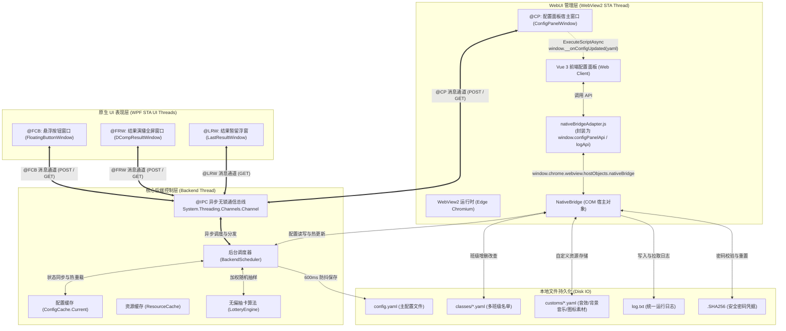
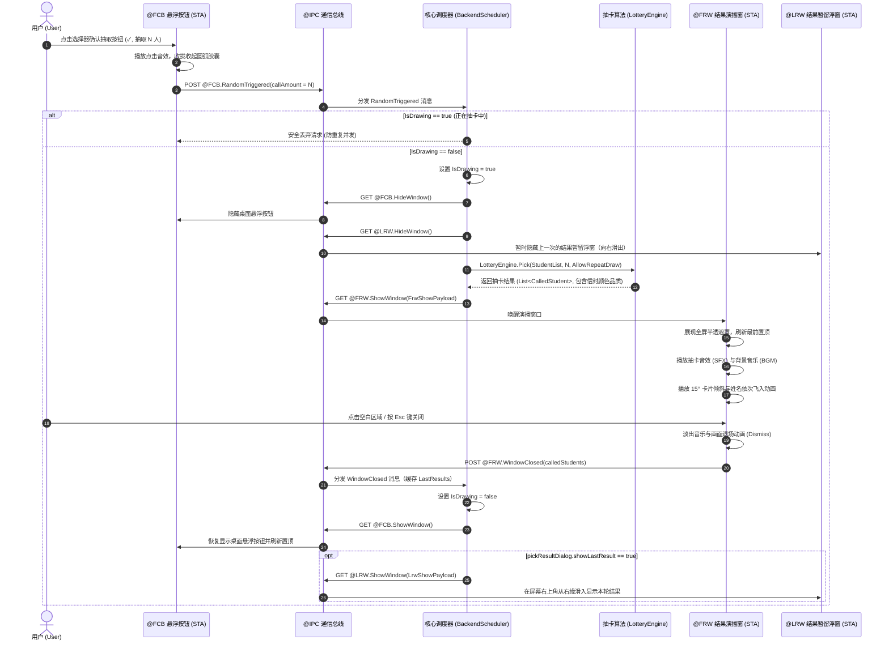
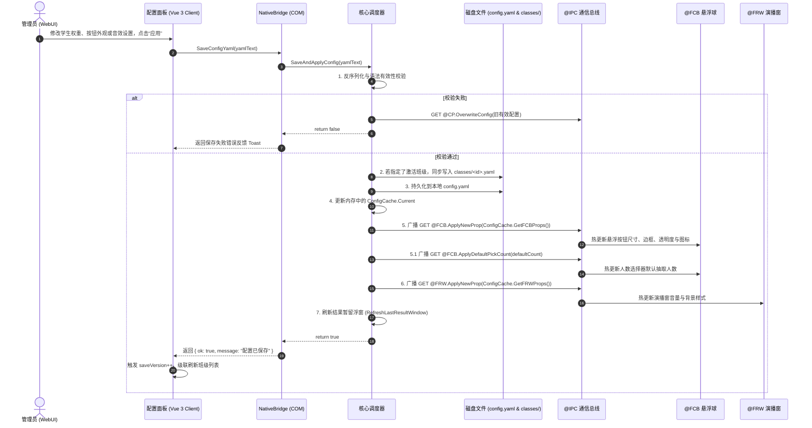
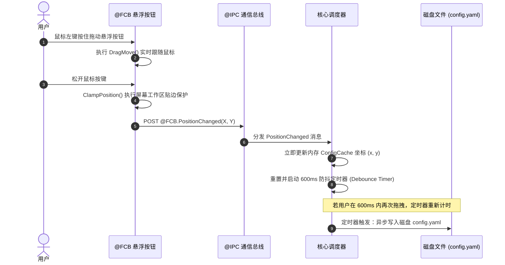
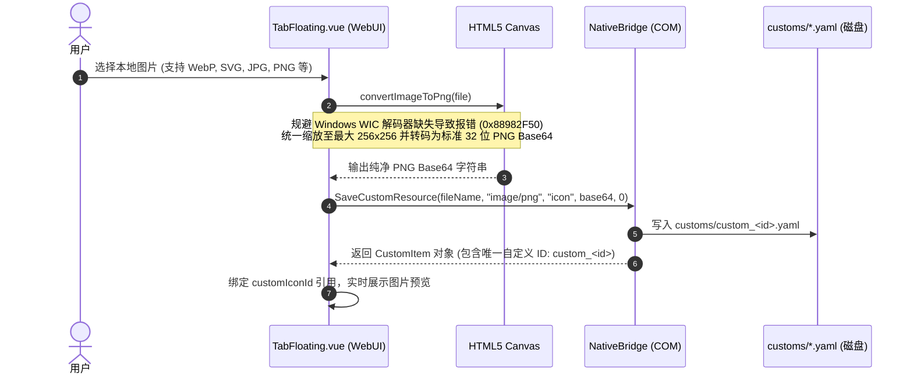

# 蔚蓝点名 (Blue Random) 通信拓扑与 IPC 接口规范

本文档系统性定义并详细阐述 **蔚蓝点名 (Blue Random)** 当前架构下的全部通信协议与接口规范。

架构基于 **单一 .NET 10 (C# / WPF) 宿主进程 + 多原生 STA 线程 + WebView2 混合前端** 模型构建，通信系统由两大核心链路组成：
1. **进程内核心消息总线 (`IpcBroker`)**：基于 `System.Threading.Channels` 的高性能无锁通道，驱动后台调度线程与各原生 UI 线程（悬浮球 `@FCB`、结果演播窗 `@FRW`、配置面板宿主 `@CP`）之间的事件传递。
2. **Web 宿主直连桥接 (`NativeBridge`)**：基于 WebView2 COM Host Object 机制（`window.chrome.webview.hostObjects.nativeBridge`），将底层配置存储、班级管理、自定义资源库、系统控制与日志服务直接暴露给前端 Vue 3 单页应用。

---

## 一、 通信架构全景拓扑



---

## 二、 进程内通信总线 (`IpcBroker`)

`IpcBroker` 是应用内部跨线程协作的唯一中枢。各个 WPF 窗口均运行在独立的 STA 线程中，通过非阻塞的无锁异步通道交换控制指令与事件数据。

### 2.1 动作语义规范 (Action Semantics)

| 动作语义 | 符号 | 枚举值 | 设计意图 |
| :--- | :---: | :---: | :--- |
| **INIT** | `INIT` | `IpcAction.Init` | **生命周期初始化**。通知组件或模块完成就绪阶段的启动与预热。 |
| **DEST** | `DEST` | `IpcAction.Dest` | **生命周期销毁**。指示窗口释放 HWND、销毁上下文、注销监听并安全关闭线程。 |
| **GET**  | `GET`  | `IpcAction.Get`  | **主动控制下发**。由调度器向 UI 模块下达显隐、位移、热更等控制指令。 |
| **POST** | `POST` | `IpcAction.Post` | **事件与交互上报**。由 UI 模块向调度器汇报用户操作（点击抽取、拖拽定位、关闭窗体等）。 |

### 2.2 消息模型定义 (`IpcMessage`)

```csharp
namespace BlueRandom.Core.Ipc;

public enum IpcAction { Init, Dest, Get, Post }
public enum IpcModule { Ipc, Fcb, Frw, Cp, Lrw }

public sealed class IpcMessage
{
    public IpcAction Action { get; init; }      // 动作语义: Init, Dest, Get, Post
    public IpcModule Module { get; init; }      // 目标/来源模块: Ipc, Fcb, Frw, Cp, Lrw
    public string Command { get; init; }        // 动作标识命令
    public object? Payload { get; init; }       // 强类型载荷数据
    public DateTime Timestamp { get; init; }    // 消息生成时间戳
}
```

### 2.3 核心总线 API 规范

```csharp
// 初始化异步通道与后台工作循环
public static void Initialize();

// 发送一条 IPC 消息到总线通道 (非阻塞写入)
public static void Send(IpcMessage message);

// 订阅指定模块的消息 (模块内部通常在构造函数中注册)
public static void Subscribe(IpcModule module, Action<IpcMessage> handler);
```

### 2.4 完整模块消息与指令映射表

#### 2.4.1 悬浮按钮模块 (`IpcModule.Fcb`)

| 指令名称 (`Command`) | 动作 | 传递方向 | 载荷类型 (`Payload`) | 说明 |
| :--- | :---: | :---: | :--- | :--- |
| **`RandomTriggered`** | `POST` | FCB $\to$ 后端 | `int` (1 ~ 10) | 用户点击选择器确认按钮 (✓) 触发抽取。后端校验 `IsDrawing` 状态机后启动抽卡。 |
| **`PositionChanged`** | `POST` | FCB $\to$ 后端 | `FcbPositionPayload` | 悬浮球被拖拽松手后上报。包含 `MonitorNumber`、`PositionX`、`PositionY`。后端更新 `ConfigCache` 并触发 600ms 防抖磁盘保存。 |
| **`HideWindow`** | `GET` | 后端 $\to$ FCB | `null` | 隐藏悬浮球（抽卡演播窗打开期间，防止悬浮球遮挡演播视线）。 |
| **`ShowWindow`** | `GET` | 后端 $\to$ FCB | `null` | 恢复显示悬浮球，并调用 Win32 刷新置顶状态。 |
| **`ApplyNewProp`** | `GET` | 后端 $\to$ FCB | `FloatingButtonConfig` | 外观属性热更新。实时重新计算几何弧形、缩放比例、边框色与图标。 |
| **`ApplyDefaultPickCount`** | `GET` | 后端 $\to$ FCB | `int` | 热更新人数选择器的默认抽取人数，范围由后端配置规范化为 1-10。 |
| **`MoveNewPosition`** | `GET` | 后端 $\to$ FCB | `FcbPositionPayload` | 主动移动悬浮按钮到目标屏幕坐标并进行边界校正。 |
| **`Destroy`** | `DEST` | 后端 $\to$ FCB | `null` | 关闭悬浮按钮窗口并释放线程。 |

#### 2.4.2 结果演播浮窗模块 (`IpcModule.Frw`)

| 指令名称 (`Command`) | 动作 | 传递方向 | 载荷类型 (`Payload`) | 说明 |
| :--- | :---: | :---: | :--- | :--- |
| **`ShowWindow`** | `GET` | 后端 $\to$ FRW | `FrwShowPayload` | 后端抽卡算法完成后下发。包含 `Amount` 和 `CalledStudents` 列表。FRW 淡入全屏遮罩、播放音效与 BGM、执行 15° 卡片倾斜与姓名逐个飞入弹跳动效。 |
| **`WindowClosed`** | `POST` | FRW $\to$ 后端 | `List<CalledStudent>` | 演播窗口完成退场动画后上报本轮名单。后端缓存为“上一次抽取结果”，重置 `IsDrawing = false`，下发 `ShowWindow` 唤醒桌面悬浮球，并在开启结果暂留时显示 LRW。 |
| **`ApplyNewProp`** | `GET` | 后端 $\to$ FRW | `PickResultDialogConfig` | 热更新演播窗外观、背景半透明度与音量配置。 |
| **`Destroy`** | `DEST` | 后端 $\to$ FRW | `null` | 停止所有音视频播放，销毁演播窗口并释放线程。 |

#### 2.4.3 结果暂留浮窗模块 (`IpcModule.Lrw`)

| 指令名称 (`Command`) | 动作 | 传递方向 | 载荷类型 (`Payload`) | 说明 |
| :--- | :---: | :---: | :--- | :--- |
| **`ShowWindow`** | `GET` | 后端 $\to$ LRW | `LrwShowPayload` | 抽取演播结束且 `pickResultDialog.showLastResult = true` 时下发。窗口固定显示在主屏工作区右上角，卡片从屏幕右缘滑入，列出本轮学生与信封品阶。 |
| **`HideWindow`** | `GET` | 后端 $\to$ LRW | `null` | 新抽取开始时、或关闭 `showLastResult` 开关时下发，向右滑出隐藏暂留浮窗。 |
| **`ApplyNewProp`** | `GET` | 后端 $\to$ LRW | `PickResultDialogConfig` | 同步暂留浮窗的背景色、边框色、不透明度与自动关闭时长（不透明度同时作用于卡片内的姓名片、徽标与进度条）。 |
| **`Destroy`** | `DEST` | 后端 $\to$ LRW | `null` | 关闭窗口并结束 LRW 线程消息循环。 |

> LRW 的关闭按钮仅隐藏窗口（不影响配置开关），下一次抽取结束后会再次自动显示。

#### 2.4.4 配置面板宿主模块 (`IpcModule.Cp`)

| 指令名称 (`Command`) | 动作 | 传递方向 | 载荷类型 (`Payload`) | 说明 |
| :--- | :---: | :---: | :--- | :--- |
| **`ShowConfigPanel`** | `GET` | 后端 $\to$ CP | `null` | 托盘菜单点击“配置”时下发。将配置窗口取消最小化/隐藏状态，显示并激活到最前台。 |
| **`ConfigSaved`** | `POST` | CP $\to$ 后端 | `string` (YAML 文本) | 前端点击“应用”时上报。后端执行 YAML 反序列化校验、班级名单同步、写盘持久化、更新 `ConfigCache`，并广播 `ApplyNewProp` 与 `ApplyDefaultPickCount` 给 FCB。 |
| **`OverwriteConfig`** | `GET` | 后端 $\to$ CP | `string` (YAML 文本) | 保存校验失败时回滚覆写，或后端主动向前端同步最新配置。 |
| **`Destroy`** | `DEST` | 后端 $\to$ CP | `null` | 销毁配置面板窗口及 WebView2 运行时。 |

#### 2.4.5 全局控制模块 (`IpcModule.Ipc`)

| 指令名称 (`Command`) | 动作 | 传递方向 | 载荷类型 (`Payload`) | 说明 |
| :--- | :---: | :---: | :--- | :--- |
| **`Initialize`** | `INIT` | 启动管线 $\to$ 系统 | `null` | 启动管线 Stage 4 完成跨线程调度总线初始化。 |
| **`Destroy`** | `DEST` | 退出请求 $\to$ 系统 | `null` | 广播退出信号，向所有组件下发 `Destroy` 并优雅关闭进程。 |

---

## 三、 WebView2 宿主直连桥接 (`NativeBridge`)

为了避免大型 JSON 字符串、高频文件读写和音视频 Base64 经过 IPC 通道产生冗余拷贝，配置面板的前端 Web 页面通过 WebView2 原生 COM 注入机制与 C# 宿主进行点对点高速直连。

### 3.1 注入与暴露机制

在 `ConfigPanelWindow.xaml.cs` 中，初始化 WebView2 环境后即刻完成宿主对象注入：
```csharp
await WebViewControl.EnsureCoreWebView2Async();
WebViewControl.CoreWebView2.AddHostObjectToScript("nativeBridge", new NativeBridge(this));
```
在前端 JavaScript 中，该对象可通过全局路径访问：
```javascript
window.chrome.webview.hostObjects.nativeBridge
```

### 3.2 C# `NativeBridge` 接口全量方法定义

```csharp
[ComVisible(true)]
public class NativeBridge
{
    // ==================== 1. 主配置管理 ====================
    // 读取当前生效的完整 config.yaml 内容 (附带标准化中文注释与协议版本)
    public string GetConfigYaml();

    // 保存 YAML 配置文本，进行严格校验，同步班级并触发全工程热重载广播
    public bool SaveConfigYaml(string yaml);

    // 重置配置：清空自定义资源、重置班级、覆盖默认 config.yaml 并重新加载
    public bool ResetConfig();

    // ==================== 2. 班级管理直连 (classes/) ====================
    // 列出所有已保存班级元数据及当前激活的班级 ID (返回 JSON 字符串)
    public string ListClassesJson();

    // 创建新班级，自动生成唯一 classId 并写入 classes/<classId>.yaml
    public string CreateClass(string name);

    // 重命名指定班级
    public bool RenameClass(string classId, string newName);

    // 删除指定班级
    public bool DeleteClass(string classId);

    // ==================== 3. 自定义资源库 (customs/) ====================
    // 保存自定义资源 (图标、音效、BGM)，写入 customs/custom_<id>.yaml
    public string SaveCustomResource(string fileName, string mimeType, string purpose, string base64, double duration);

    // 根据 resourceId 读取指定资源元数据与 Base64 (返回 JSON 字符串)
    public string GetCustomResourceJson(string customId);

    // 删除指定自定义资源
    public bool DeleteCustomResource(string customId);

    // ==================== 4. 系统特权与外部操作 ====================
    // 弹出 Windows 原生文件选择对话框 (支持传入自定义文件过滤器)
    public string PickFile(string filter);

    // 在资源管理器中打开用户配置数据目录 (%USERPROFILE%\.blue random)
    public void OpenConfigFolder();

    // 在系统默认浏览器中打开外部超链接
    public void OpenUrl(string url);

    // 清理 WebView2 缓存 (EBWebView) 并重新预热 ResourceCache
    public void ClearCache();

    // 获取宿主应用与系统运行环境信息 (版本号、代号、管理员状态、UIAccess 状态等，返回 JSON)
    public string GetAppInfoJson();

    // 检查 GitHub Releases 最新版本 (异步双模校验：API 优先 + 302 重定向探针兜底，返回 JSON)
    public async Task<string> CheckUpdateJson();

    // 通过 Windows schtasks 创建/更新开机自动启动计划任务
    public bool CreateStartupTask(string taskName, string exePath, bool asAdmin);

    // 请求以管理员权限重启当前应用程序
    public void AdminElevate();

    // 普通重启当前应用程序
    public void Restart();

    // ==================== 5. 安全管理 (.SHA256) ====================
    // 检查是否启用了密码保护 (是否存在 .SHA256 凭据文件)
    public bool IsSecurityEnabled();

    // 验证用户输入的明文密码与 .SHA256 摘要是否匹配
    public bool VerifyPassword(string pwd);

    // 设置或更新密码摘要
    public bool SetPassword(string pwd);

    // 验证密码正确后解除并注销密码保护
    public bool DisablePassword(string pwd);

    // 忘记密码时的全量清空与重置
    public bool ResetAllConfig();

    // ==================== 6. 窗口交互与日志 ====================
    // 关闭/隐藏配置面板窗口
    public void CloseWindow();

    // 打开 WebView2 开发者工具 (DevTools)
    public void OpenDevTools();

    // 读取当前悬浮按钮的实时屏幕坐标 (返回 JSON: { "x": ..., "y": ... })
    public string GetFloatingPositionJson();

    // 分页倒序提取 log.txt 的历史运行日志 (返回格式化 JSON 数组)
    public string GetLogsJson(int maxLines);

    // 接收 WebUI 内部日志并转入 AppLogger 统一输出
    public void Log(string level, string message);
}
```

---

## 四、 前端适配层 API 规范 (`window.configPanelApi`)

前端在 `src/renderer/bridge/nativeBridgeAdapter.js` 中将 COM 宿主对象包装为纯异步 Promise 风格的 API，消除了 COM 原生数据类型转换细节，并在 C# 宿主缺失时提供纯前端开发调试兜底。

### 4.1 `window.configPanelApi` 接口对照表

| 方法名 | 参数 | 返回值类型 | 对应 C# `NativeBridge` 方法 | 说明 |
| :--- | :--- | :--- | :--- | :--- |
| **`getConfig()`** | 无 | `Promise<Object\|null>` | `GetConfigYaml()` | 读取 YAML 并通过 `js-yaml` 解析为前端响应式 JavaScript 配置对象。 |
| **`saveConfig(configObj)`** | `configObj: Object` | `Promise<{ ok: boolean, message?: string }>` | `SaveConfigYaml(yaml)` | 将 JavaScript 配置对象序列化为 YAML 文本并请求后端保存与广播热更。 |
| **`close(saved)`** | `saved?: boolean` | `Promise<void>` | `CloseWindow()` | 关闭/隐藏配置面板窗口。 |
| **`getAppInfo()`** | 无 | `Promise<AppInfoObject>` | `GetAppInfoJson()` | 获取系统环境、版本号、版本代号、UIAccess 状态与路径信息。 |
| **`openConfigFile()`** | 无 | `Promise<void>` | `OpenConfigFolder()` | 打开配置数据所在目录。 |
| **`openConfigDir()`** | 无 | `Promise<void>` | `OpenConfigFolder()` | 在资源管理器中打开用户配置数据目录。 |
| **`openUrl(url)`** | `url: string` | `Promise<void>` | `OpenUrl(url)` | 打开外部超链接。若无宿主环境则调用 `window.open`。 |
| **`clearCache()`** | 无 | `Promise<{ ok: boolean, message: string }>` | `ClearCache()` | 清理内存与磁盘会话缓存。 |
| **`resetConfig()`** | 无 | `Promise<{ ok: boolean, message: string }>` | `ResetConfig()` | 恢复出厂配置。 |
| **`createStartupTask(payload)`** | `{ taskName, exePath, admin }` | `Promise<{ ok: boolean, message: string }>` | `CreateStartupTask(...)` | 创建或更新 Windows 开机自启计划任务。 |
| **`adminElevate()`** | 无 | `Promise<void>` | `AdminElevate()` | 发起管理员 UAC 提权并重启。 |
| **`restart()`** | 无 | `Promise<void>` | `Restart()` | 重启应用程序。 |
| **`openDevTools()`** | 无 | `Promise<void>` | `OpenDevTools()` | 唤起 WebView2 开发者调试控制台。 |
| **`getFloatingPosition()`** | 无 | `Promise<{ x: number, y: number }\|null>` | `GetFloatingPositionJson()` | 实时获取悬浮球当前屏幕坐标。 |
| **`getLogs(maxLines)`** | `maxLines?: number` | `Promise<Array<LogEntry>>` | `GetLogsJson(maxLines)` | 按时间正序读取运行日志条目。 |
| **`pickExeFile()`** | 无 | `Promise<string>` | `PickFile(...)` | 选取 Windows 可执行程序路径 (`*.exe`)。 |
| **`listClasses()`** | 无 | `Promise<{ ok: boolean, classes: ClassItem[], activeClassId: string }>` | `ListClassesJson()` | 获取班级库及当前激活班级 ID。 |
| **`createClass(name)`** | `name: string` | `Promise<{ ok: boolean, class: ClassItem }>` | `CreateClass(name)` | 创建新班级名单。 |
| **`renameClass(id, name)`** | `id: string, name: string` | `Promise<{ ok: boolean, message: string }>` | `RenameClass(id, name)` | 重命名班级。 |
| **`deleteClass(id)`** | `id: string` | `Promise<{ ok: boolean, message: string }>` | `DeleteClass(id)` | 删除班级名单。 |
| **`saveCustom(payload)`** | `{ fileName, mimeType, purpose, base64, duration }` | `Promise<{ ok: boolean, id: string, ... }>` | `SaveCustomResource(...)` | 保存自定义资源素材（图标、音效、BGM）。 |
| **`getCustom(id)`** | `id: string` | `Promise<CustomItem\|null>` | `GetCustomResourceJson(id)` | 加载指定资源元数据与 Base64。 |
| **`deleteCustom(id)`** | `id: string` | `Promise<{ ok: boolean }>` | `DeleteCustomResource(id)` | 删除指定自定义素材。 |
| **`getSecurityStatus()`** | 无 | `Promise<{ enabled: boolean }>` | `IsSecurityEnabled()` | 获取密码保护是否开启。 |
| **`verifyPassword(pwd)`** | `pwd: string` | `Promise<{ ok: boolean, message: string }>` | `VerifyPassword(pwd)` | 验证密码。 |
| **`setPassword(pwd)`** | `pwd: string` | `Promise<{ ok: boolean, message: string }>` | `SetPassword(pwd)` | 设置新密码。 |
| **`disablePassword(pwd)`** | `pwd: string` | `Promise<{ ok: boolean, message: string }>` | `DisablePassword(pwd)` | 关闭密码保护。 |
| **`resetAllConfig()`** | 无 | `Promise<{ ok: boolean, message: string }>` | `ResetAllConfig()` | 忘记密码时的全量重置。 |
| **`checkUpdate()`** | 无 | `Promise<UpdateCheckResult>` | `CheckUpdateJson()` | 检查版本更新。若无宿主环境自动回退至直接拉取 GitHub API。 |

### 4.2 `window.logApi` 规范

用于将前端 WebUI 产生的日志无缝转交 C# 宿主统一日志系统：
```javascript
window.logApi = {
  send: (level, text) => {
    const b = window.chrome?.webview?.hostObjects?.nativeBridge;
    if (b) b.Log(level, String(text || ''));
  }
};
```
在 `main.js` 中拦截了全量 `console.warn` 和 `console.error`，自动调用 `window.logApi.send` 写入 `log.txt`。

---

## 五、 后端主动向前端推送事件

当后端通过其它途径修改了配置（如悬浮球拖拽松手持久化更新坐标、协议升级自动迁移等）时，C# 宿主通过 WebView2 的 `ExecuteScriptAsync` 执行脚本反向通知前端更新表单数据：

```csharp
// ConfigPanelWindow.xaml.cs
public async Task PushConfigUpdateToWebAsync(string yaml)
{
    string escaped = JsonSerializer.Serialize(yaml);
    await WebViewControl.ExecuteScriptAsync($"if (window.__onConfigUpdated) window.__onConfigUpdated({escaped});");
}
```

前端只需在根作用域注册监听函数：
```javascript
window.__onConfigUpdated = (newYaml) => {
  const newConfig = yaml.load(newYaml);
  Object.assign(draft, newConfig);
};
```

---

## 六、 核心业务全景交互时序图

### 6.1 抽卡全生命周期交互流程



### 6.2 配置保存与全模块热更新交互流程



### 6.3 悬浮按钮拖拽与防抖持久化时序



### 6.4 自定义素材安全转码与存储流程



---

## 七、 数据结构与载荷字典

### 7.1 `FcbPositionPayload`
```csharp
public sealed class FcbPositionPayload
{
    public int MonitorNumber { get; set; } = 0;
    public int PositionX { get; set; }
    public int PositionY { get; set; }
}
```

### 7.2 `FrwShowPayload`
```csharp
public sealed class FrwShowPayload
{
    public int Amount { get; set; }
    public List<CalledStudent> CalledStudents { get; set; } = new();
}

public sealed class CalledStudent
{
    public string Name { get; set; } = "";
    public string LetterColor { get; set; } = "rainbow"; // rainbow, gold, blue
}
```

### 7.3 `LrwShowPayload`
```csharp
public sealed class LrwShowPayload
{
    public List<CalledStudent> CalledStudents { get; set; } = new();
    public DateTime DrawnAt { get; set; }
}
```

### 7.4 `AppInfo` JSON 结构
```json
{
  "version": "26.10.04",
  "codename": "Midori",
  "isAdmin": false,
  "isUiAccess": false,
  "uiAccessDllExists": true,
  "configPath": "C:\\Users\\User\\.blue random\\config.yaml",
  "configDir": "C:\\Users\\User\\.blue random",
  "exePath": "C:\\Program Files\\Blue Random\\BlueRandom.exe"
}
```

### 7.5 `ClassConfig` JSON 结构
```json
{
  "classId": "classes_a1b2c3d4",
  "name": "高一一班",
  "studentList": [
    {
      "name": "早濑优香",
      "weight": 1.5,
      "letterColor": "rainbow"
    },
    {
      "name": "生盐诺亚",
      "weight": 1.0,
      "letterColor": "gold"
    }
  ]
}
```

### 7.6 `CustomItem` JSON 结构
```json
{
  "id": "custom_1725000000000",
  "fileName": "my_icon.png",
  "mimeType": "image/png",
  "purpose": "icon",
  "duration": 0.0,
  "base64": "iVBORw0KGgoAAAANSUhEUgAA..."
}
```

### 7.7 `UpdateCheckResult` JSON 结构
```json
{
  "ok": true,
  "status": "update",
  "title": "发现新版本：Shiroko-v26.11.01",
  "detail": "- 新增全屏抽卡粒子动效\n- 修复高分屏缩放下的坐标偏移问题",
  "releaseUrl": "https://github.com/Yun-Hydrogen/blue-random/releases/tag/Shiroko-v26.11.01",
  "remoteVersion": "26.11.01",
  "remoteCodename": "Shiroko"
}
```
Status 取值包括：
- `update`: 云端有更高版本可用。
- `ok`: 当前已是最新版本。
- `warn`: 本地版本号高于云端版本（开发预览版）。
- `error`: 检查过程发生网络或解析异常。
